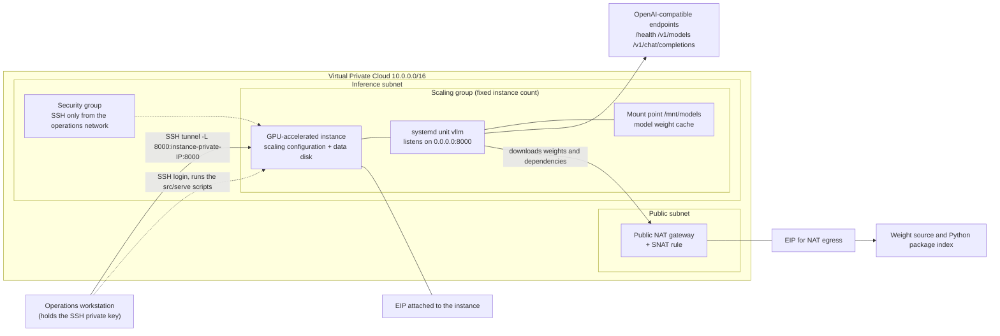

# Large Model Inference on GPU-Accelerated Instances (Huawei Cloud Practice)

[](LICENSE)
[](https://www.huaweicloud.com)

## Introduction

This practice uses Terraform to provision a GPU-accelerated instance on Huawei Cloud and runs the [vLLM](https://github.com/vllm-project/vllm) OpenAI-compatible inference service inside that instance under systemd supervision. It delivers one complete path: from an empty directory to a chat completion that `curl` can call successfully.

The point it addresses is that an inference deployment usually leaves five loose ends: **instance flavor selection, GPU driver availability, model weight caching, service self-recovery, and the access path**. This practice turns those five into reproducible declarative configuration plus a small set of operations scripts:

- Flavor selection stays with the operator. GPU flavors are offered only in selected availability zones, so nothing is picked automatically: `var.gpu_flavor` must be stated explicitly (see Prerequisites and Step-by-step deployment).
- Driver and cache concerns are handled by the image and the data disk. The instance bootstrap script verifies `nvidia-smi` first and stops with a written reason when the driver is missing; the data disk is formatted and mounted persistently, so weights survive instance rebuilds without re-downloading.
- Self-recovery is handled by systemd. A crashed process is relaunched after 10 seconds, and the service returns after an instance restart; the scaling group performs health audits and replaces unhealthy instances.
- The access path is handled by SSH tunneling. The inference port listens only on the instance itself and inside the VPC, and the security group opens only SSH from the operations network, so the service is never exposed to the public internet.

Who it is for: developers and operations engineers who need a single GPU instance to serve a persistent OpenAI-compatible endpoint on Huawei Cloud, and readers who want to see how "Terraform declaration + instance bootstrap + runtime operations scripts" fit together.

## Table of Contents

- [Introduction](#introduction)
- [Architecture Diagram](#architecture-diagram)
- [Highlights](#highlights)
- [Huawei Cloud Services Used](#huawei-cloud-services-used)
- [Prerequisites](#prerequisites)
- [Quick Start](#quick-start)
- [Step-by-step Deployment](#step-by-step-deployment)
- [Usage and Verification](#usage-and-verification)
- [Repository Layout](#repository-layout)
- [Clean Up Resources](#clean-up-resources)
- [Further Reading](#further-reading)
- [FAQ and Troubleshooting](#faq-and-troubleshooting)
- [License](#license)
- [Contact](#contact)

## Architecture Diagram



Description:

1. **Network.** Two subnets inside one VPC. The inference subnet hosts the GPU instance, the public subnet hosts the public NAT gateway. Weight downloads and dependency installs leave through NAT. When a public NAT gateway is created, the platform injects the 0.0.0.0/0 next hop into the default route table of the VPC, so no default route is declared here.
2. **Entry points.** Every instance created by the scaling group automatically receives a public address used only as the SSH operations entry. The only ingress rule in the security group allows SSH from `var.ops_cidr`; the inference port has no ingress rule at all.
3. **Call path.** The operations workstation forwards the remote inference port to the same local port over SSH, then sends every HTTP request to `http://127.0.0.1:<port>` as if the service were local.
4. **Inside the instance.** `user_data` in the scaling configuration carries the rendered bootstrap script. On first boot it validates the GPU driver, mounts the data disk, builds a private virtual environment, writes the systemd unit, starts the service, and probes `/health` within a bounded window.
5. **Liveness.** `Restart=always` with `RestartSec=10` gives process-level recovery; `NOVA_AUDIT` health auditing gives instance-level replacement.

## Highlights

- **Flavor decisions stay explicit.** Flavor, availability zone, disk types and sizes, bandwidth mode and network mode are all input variables. Nothing relies on provider defaults, so a wrong shape is visible before deployment instead of after.
- **The bootstrap script validates its own prerequisites.** Without a GPU driver it stops and records which variable to change, rather than letting vLLM fail minutes later with an unrelated error.
- **Weight cache is decoupled from the instance.** A separate data disk persists the cache directory (`HF_HOME`), while `delete_volume = true` releases the disk together with the instance, so nothing unclaimed is left behind.
- **Parameter names line up across three layers.** The input variables in `infra/variables.tf`, the systemd unit rendered from `infra/templates/vllm_bootstrap.sh.tpl`, and the arguments of the `src/serve/` scripts map one to one. Runtime scripts resolve values in the order command line, same-named environment variable, effective service configuration on the instance, documented default, so they never drift from the deployment declaration.
- **The inference service is never public.** The only reachable public port is SSH from a restricted network, and inference traffic goes over the tunnel.
- **Client scripts prove themselves offline.** Request body construction, address resolution and error classification in `src/client/` are covered by unit tests that run before any deployment.

## Huawei Cloud Services Used

| Huawei Cloud service | Terraform resource | Role in this practice |
|-|-|-|
| Virtual Private Cloud | `huaweicloud_vpc` | Isolated network hosting the inference instance and the NAT gateway; CIDR from `var.vpc_cidr` |
| Subnet | `huaweicloud_vpc_subnet.public` / `.private` | Public subnet hosts the NAT gateway, inference subnet hosts the GPU instance |
| Public NAT gateway | `huaweicloud_nat_gateway` | Egress path for the inference subnet; size from `var.nat_spec` |
| SNAT rule | `huaweicloud_nat_snat_rule` | Source address translation for the whole inference subnet, used for weight downloads and dependency installs |
| Elastic IP and bandwidth | `huaweicloud_vpc_eip`, `public_ip` inside the scaling configuration | One for NAT egress, one for the SSH operations entry of the instance |
| Security group | `huaweicloud_networking_secgroup` / `_rule` | Ingress allows only SSH from `var.ops_cidr`; the inference port stays closed |
| Key Pair (KPS) | `huaweicloud_kps_keypair` | Registers the public key only; the private key stays on the operations workstation |
| Image Management Service | `data.huaweicloud_images_image` | Locates the instance image among public images of the region by an anchored regular expression |
| Elastic Cloud Server | Instances created by the scaling group | GPU-accelerated instance running the inference service |
| Elastic Volume Service | `disk` blocks (SYS / DATA) in the scaling configuration | System disk holds the runtime, data disk persists the weight cache |
| Auto Scaling | `huaweicloud_as_configuration` / `huaweicloud_as_group` | Instance template plus instance count, availability zone, health audit and replacement policy |

## Prerequisites

**Account and permissions**

- A Huawei Cloud account with Elastic Cloud Server, Auto Scaling, Virtual Private Cloud, NAT Gateway, Elastic IP, EVS, Key Pair and Image services enabled.
- The executing identity holds deployment permissions for those services, including creating and deleting resources.
- Obtain an Access Key ID and a Secret Access Key from the "My Credentials" page of the Huawei Cloud console and put them where `infra/providers.tf` describes, in the deployment script. Never keep credentials in code or commit them to the repository.

**Tooling**

- Terraform `>= 1.5.0` (declared in `infra/versions.tf`).
- huaweicloud provider `~> 1.96.1` (declared in `infra/versions.tf`).
- Python 3.8 or later plus `requests` for the client scripts (`python3 -m pip install requests`).
- bash 4+, `curl` and systemd (`systemctl`) inside the instance for the operations scripts; `nvidia-smi`, which comes with the GPU driver, is needed for the memory usage field.

**Region and availability zone constraints (confirm every item)**

- Target region defaults to `cn-north-4`.
- **GPU flavors are offered only in selected availability zones.** `var.availability_zone` must be one where your chosen flavor is actually available. In `cn-north-4` that means `cn-north-4b` or `cn-north-4c`.
- **`var.gpu_flavor` must be supplied by the operator based on the real availability of the target zone.** The default `g5.2xlarge.8` exists only so that the template can be validated; it guarantees nothing about availability. Override it in `terraform.tfvars` with a flavor you confirmed as sellable before deploying. A mismatch between zone and flavor makes the scaling group fail to create instances.
- When the flavor changes, re-check GPU memory and card count, and adjust `var.gpu_memory_utilization`, `var.max_model_len` and `var.tensor_parallel_size` accordingly. `var.tensor_parallel_size` must equal the number of GPUs attached to the instance.

**Image constraints**

- The instance image must ship with the GPU driver preinstalled. Both `var.image_id` and `var.image_name_regex` default to empty, and one of them must be provided before deploying: confirm the driver-preinstalled image name and ID for the current region in the console under "Elastic Cloud Server - Public Images", then either set `var.image_id` to that image, or rewrite `var.image_name_regex` as an anchored expression for that name (anchoring with `^` and `$` is mandatory, otherwise a similarly named image gets selected). If both stay empty, the plan aborts instead of creating an instance that cannot serve inference.
- With a general image, the bootstrap script inside the instance stops and records "GPU driver not detected" in the log, and the service never starts.

**Access constraints**

- Prepare an SSH key pair: put the public key into `var.ssh_public_key` (OpenSSH format) and keep the private key local only.
- `var.ops_cidr` is required and must not be `0.0.0.0/0`. Narrow the source to the operations egress address, in the form `<fixed public IP of the operations machine>/32`.
- **The inference service listens only on the instance itself and inside the VPC; the security group does not open the inference port.** Before calling it from your workstation, establish an SSH tunnel. The exact command form is in "Usage and Verification".

**Egress constraints**

- The first boot reaches the weight source and the Python package index. Defaults are `var.model_source_base_url = "https://huggingface.co"` and `var.python_package_index_url = "https://pypi.tuna.tsinghua.edu.cn/simple"`; switch both to a closer mirror for your region to shorten the first startup.

## Quick Start

```bash
cd infra
cp terraform.tfvars.example terraform.tfvars
# Edit terraform.tfvars: at minimum override gpu_flavor / availability_zone /
# image_id (or an anchored image_name_regex) / ssh_public_key / ops_cidr
terraform init
terraform plan  -var-file=terraform.tfvars
terraform apply -var-file=terraform.tfvars
```

Expected output (key lines):

- `terraform validate`: `Success! The configuration is valid`.
- End of `terraform apply`: `Apply complete! Resources: <N> added, 0 changed, 0 destroyed.` followed by the `Outputs:` block, which contains `access_guide`, the same steps reproduced in "Usage and Verification".
- Time from instance start to a ready service is usually 8 to 15 minutes, spent downloading and loading model weights.

## Step-by-step Deployment

### Step 1: confirm flavor and availability zone

Check the console, or call the flavor query API, and record the GPU flavor actually sellable in the target zone together with its GPU card count.

Expected result: a string shaped like `<family>.<name>`, for example `g5.2xlarge.8`, plus the number of GPUs it attaches (used for `var.tensor_parallel_size`).

### Step 2: confirm the image

In the region's "Elastic Cloud Server - Public Images" list, confirm the name and ID of the image that ships with the GPU driver.

Expected result: an image ID, or the exact image name to anchor on.

### Step 3: fill in the variables

Copy the example file and adjust it. `ssh_public_key` and `ops_cidr` have no defaults and must be provided.

```bash
cd infra
cp terraform.tfvars.example terraform.tfvars
```

| Variable | Type | Default | Required | Notes and allowed values |
|-|-|-|-|-|
| `region` | string | `cn-north-4` | no | Huawei Cloud region |
| `availability_zone` | string | `cn-north-4b` | no | Must be a zone where `var.gpu_flavor` is actually available; in `cn-north-4` only `4b` / `4c` carry GPU flavors |
| `name_prefix` | string | `vllm-gpu` | no | Common prefix for every resource name |
| `vpc_id` | string | `""` | no | ID of an existing VPC; empty means create one |
| `public_subnet_id` | string | `""` | no | ID of an existing subnet hosting the NAT gateway; empty means create one |
| `private_subnet_id` | string | `""` | no | ID of an existing subnet hosting the inference instance; empty means create one |
| `vpc_cidr` | string | `10.0.0.0/16` | no | CIDR of the newly created VPC |
| `public_subnet_cidr` | string | `10.0.1.0/24` | no | CIDR of the newly created public subnet |
| `public_subnet_gateway_ip` | string | `10.0.1.1` | no | Must fall inside `public_subnet_cidr` |
| `private_subnet_cidr` | string | `10.0.10.0/24` | no | CIDR of the newly created inference subnet |
| `private_subnet_gateway_ip` | string | `10.0.10.1` | no | Must fall inside `private_subnet_cidr` |
| `gpu_flavor` | string | `g5.2xlarge.8` | **yes** | **Must be provided by the operator according to what the target zone actually offers**; the default value only keeps the template validatable. Reference families: `g5` / `g6` / `pi2` / `p2v`, all available in selected zones only. Validation: must not be blank |
| `instance_count` | number | `1` | no | Used as the minimum, desired and maximum instance number of the scaling group (a single persistent inference server shape); range 1-10 |
| `image_id` | string | `""` | no | When set, `image_name_regex` is ignored and this image is used |
| `image_name_regex` | string | `""` | one of the two | Required when `image_id` is empty; must be anchored with `^` and `$` and must name an image that carries the GPU driver |
| `image_architecture` | string | `x86` | no | Must match the architecture of `gpu_flavor`; `x86` or `arm` |
| `system_disk_type` | string | `GPSSD` | no | One of `SSD` / `SAS` / `SATA` / `GPSSD` / `ESSD` / `GPSSD2` / `ESSD2` |
| `system_disk_size` | number | `100` | no | System disk size in GB, large enough for the runtime and weight cache; range 40-1024 |
| `enable_data_disk` | bool | `true` | no | Whether to attach a separate data disk that persists the weight cache |
| `data_disk_type` | string | `GPSSD` | no | Same allowed values as `system_disk_type` |
| `data_disk_size` | number | `200` | no | Data disk size in GB, scaled to the weight volume of the model in use; range 10-32768 |
| `enable_nat_gateway` | bool | `true` | no | Whether to create the public NAT gateway; set `false` when the instance egresses through its own public address |
| `nat_spec` | string | `1` | no | NAT gateway size: `1` (small) / `2` (medium) / `3` (large) / `4` (extra large) |
| `nat_charging_mode` | string | `postPaid` | no | Value is `postPaid` or `prePaid` |
| `nat_eip_type` | string | `5_bgp` | no | Egress EIP type; `5_bgp` is dynamic BGP |
| `nat_eip_charge_mode` | string | `traffic` | no | Bandwidth type; `traffic` or `bandwidth` |
| `nat_eip_bandwidth_size` | number | `50` | no | Bandwidth ceiling in Mbit/s: range 1-300 for `traffic`, 1-2000 for `bandwidth` |
| `instance_eip_type` | string | `5_bgp` | no | Public address type of the instance; used as the SSH operations entry only |
| `instance_eip_charge_mode` | string | `traffic` | no | Bandwidth type; `traffic` or `bandwidth` |
| `instance_eip_bandwidth_size` | number | `50` | no | Bandwidth ceiling in Mbit/s: range 1-300 for `traffic`, 1-2000 for `bandwidth` |
| `instance_eip_share_type` | string | `PER` | no | Bandwidth sharing mode: `PER` (dedicated) or `WHOLE` (shared) |
| `ssh_public_key` | string | none | **yes** | OpenSSH public key, shaped like `ssh-ed25519 AAAA... user@host`; the private key stays local and never enters the repository |
| `ops_cidr` | string | none | **yes** | Source allowed to reach SSH, shaped like `<fixed public IP of the operations machine>/32`; a valid CIDR and never `0.0.0.0/0` |
| `ssh_port` | number | `22` | no | SSH port; also used as both ends of the security group port range |
| `model_name` | string | `Qwen/Qwen2.5-0.5B-Instruct` | no | The `model` field in the request body must match this exactly |
| `max_model_len` | number | `8192` | no | Maximum sequence length the model supports |
| `gpu_memory_utilization` | string | `0.85` | no | Share of GPU memory allocated to the key-value cache; value between 0 and 1 |
| `tensor_parallel_size` | number | `1` | no | Number of GPUs used for tensor parallelism; must equal the card count of the flavor |
| `vllm_version` | string | `0.8.5` | no | Inference framework version, pinned to a version usable by the runtime |
| `vllm_port` | number | `8000` | no | Inference listen port; reachable only on the instance and inside the VPC, never exposed publicly |
| `model_source_base_url` | string | `https://huggingface.co` | no | Weight source; a closer mirror is recommended for mainland regions |
| `python_package_index_url` | string | `https://pypi.tuna.tsinghua.edu.cn/simple` | no | Package index used to install the inference framework |
| `model_cache_dir` | string | `/mnt/models/huggingface` | no | Weight cache directory; keep it under the data disk mount point `/mnt/models` when the data disk is enabled |
| `bootstrap_log_path` | string | `/var/log/vllm-setup.log` | no | Log path of the instance bootstrap script |

Expected result: `terraform plan` finishes without errors and its output shows `gpu_flavor`, `availability_zone` and `image_id` matching what you confirmed.

### Step 4: deploy

```bash
cd infra
terraform apply -var-file=terraform.tfvars
```

Expected output: `Apply complete! Resources: <N> added, 0 changed, 0 destroyed.` followed by all outputs: `region`, `availability_zone`, `vpc_id`, `instance_subnet_id`, `security_group_id`, `ssh_keypair_name`, `image_id`, `gpu_flavor`, `scaling_group_id`, `scaling_configuration_id`, `service_name`, `inference_port`, `model_name`, `access_guide`.

### Step 5: confirm the instance is up

Instances are created by the platform, so read their public and private addresses from the "Elastic Cloud Server" list, or run:

```bash
cd infra
terraform state show huaweicloud_as_group.vllm
```

After logging in, inspect the bootstrap progress:

```bash
cat /var/log/vllm-setup.log
systemctl status vllm
journalctl -u vllm --no-pager -n 50
```

Expected output: the log ends with `=== 推理服务初始化完成 ===` (inference service bootstrap finished). If it says `未检测到 GPU 驱动，无法启动推理服务。`, return to Step 2 and switch the image.

## Usage and Verification

### Before deployment: offline verification (no cloud resource needed)

```bash
python -m unittest discover -s src/client -t src/client
```

Expected output (last lines):

```text
----------------------------------------------------------------------
Ran 16 tests in 0.0Xs

OK
```

This checks request body construction, address resolution priority, the `Authorization` header switch and the error-to-exit-code mapping. It is a static check you can run before deploying.

### After deployment: establish the access path

The inference service listens only on the instance and inside the VPC, and the security group holds a single ingress rule for SSH from `var.ops_cidr`. **The inference port is not open.** Establish an SSH tunnel from the local port 8000 to the instance port 8000 and keep that terminal running:

```bash
ssh -i <local private key file> -N -L 8000:<instance private IP>:8000 root@<instance public IP>
```

This is the exact command form produced by `terraform output access_guide` and printed by the access hint at the end of `src/serve/vllm-env.sh`; both use `var.vllm_port` (default `8000`) on each side.

### After deployment: health check

Option 1, plain curl:

```bash
curl -s -o /dev/null -w "%{http_code}\n" http://127.0.0.1:8000/health
```

Expected output: `200`. A `200` means the service answers; the first start spends 8 to 15 minutes downloading and loading weights.

Option 2, the client script, which combines the health probe with a model-name confirmation:

```bash
cd src/client
python3 health_check.py --base-url http://127.0.0.1:8000/v1
```

Expected output:

```text
GET http://127.0.0.1:8000/health -> HTTP 200
GET http://127.0.0.1:8000/v1/models -> 已返回模型列表
服务已加载模型（1 个）：
  Qwen/Qwen2.5-0.5B-Instruct  <= 本次 --model
请求体 model  : Qwen/Qwen2.5-0.5B-Instruct（列表中已存在）
结果          : 通过
```

(The client scripts print their report lines in Chinese, exactly as above.)

Adding `--require-model` makes the script exit with code `5` when the served model list does not contain the `--model` value, which separates "the service is alive" from "the model name is wrong".

### After deployment: one non-streaming chat completion

```bash
cd src/client
python3 chat_completion.py --base-url http://127.0.0.1:8000/v1
```

Expected output:

```text
--- 非流式对话补全 ---
接口地址      : http://127.0.0.1:8000/v1/chat/completions
模型          : Qwen/Qwen2.5-0.5B-Instruct
首 token 延迟 : -
整体耗时      : 1234 ms
返回分片数    : 1
token 统计    : prompt=25 completion=64 total=89
返回内容      : <the generated text, up to 200 characters>
结果          : 通过
```

A non-streaming call does not measure first-token latency, so that line always shows `-`. Available arguments: `--prompt`, `--system-prompt`, `--temperature`, `--max-tokens`, `--model`, `--api-key`, `--timeout`, `--eip`, `--port`, `--skip-model-check`.

The same call in raw form:

```bash
curl http://127.0.0.1:8000/v1/chat/completions \
  -H "Content-Type: application/json" \
  -d '{"model": "Qwen/Qwen2.5-0.5B-Instruct", "messages": [{"role": "user", "content": "你好"}], "max_tokens": 100}'
```

### After deployment: one streaming chat completion

```bash
cd src/client
python3 stream_chat_completion.py --base-url http://127.0.0.1:8000/v1
```

Expected output:

```text
请求体 stream=True，逐分片读取 SSE。
--- 流式对话补全 ---
接口地址      : http://127.0.0.1:8000/v1/chat/completions
模型          : Qwen/Qwen2.5-0.5B-Instruct
首 token 延迟 : 412 ms
整体耗时      : 1500 ms
返回分片数    : 62
返回内容      : <the generated text, up to 200 characters>
结果          : 通过
```

Streaming prints a summary only by default; add `--show-chunks` to print each piece on its own line. If no non-empty piece arrives, an extra hint asks you to confirm that the service really answers in streaming form.

### After deployment: runtime operations inside the instance

These scripts run as root inside the inference instance (`vllm-env.sh` is the shared function library they source, not a standalone entry point). They are not part of the scaling configuration `user_data`, so upload them once first, for example to `/opt/src/serve/`:

```bash
scp -i <local private key file> src/serve/*.sh root@<instance public IP>:/opt/src/serve/
```

Then run them inside the instance:

```bash
src/serve/vllm-status.sh            # service state, port listen, GPU memory, endpoint probe; read-only
src/serve/vllm-logs.sh -n 50        # service output plus the bootstrap log
src/serve/vllm-start.sh --dry-run   # prints effective parameters and unit content, changes nothing
src/serve/vllm-stop.sh              # stops the service process inside the instance; the scaling group is untouched
```

Run from the operations workstation works as well: fields that need `systemctl` or `nvidia-smi` are skipped automatically.

`vllm-status.sh` exits `0` when the health probe returns 200 and `1` otherwise, writing the reason line by line. From the operations workstation, with a tunnel already up, the endpoint fields can be probed directly:

```bash
src/serve/vllm-status.sh --port 8000
```

### Exit codes of the client scripts

| Code | Meaning | Typical handling |
|-|-|-|
| `0` | Success | — |
| `2` | Cannot reach the service | Tunnel not established, or weights still loading |
| `3` | Request timeout | Increase `--timeout` and retry |
| `4` | Rejected (401/403) | Pass the real key with `--api-key`, or set `VLLM_API_KEY` |
| `5` | Model not found (404) | Align with the names listed by `health_check.py` (maps to `var.model_name`) |
| `6` | Server returned 5xx | Inspect `src/serve/vllm-logs.sh -n 100` |
| `7` | Response shape or address invalid | Check the scheme and the assembled `--base-url` |
| `8` | `requests` missing | `python3 -m pip install requests` |

Value precedence: command line, then the same-named environment variable (`VLLM_BASE_URL` / `VLLM_EIP` / `VLLM_PORT` / `MODEL_NAME` / `VLLM_API_KEY` / `REQUEST_TIMEOUT` / `MAX_TOKENS` / `SMOKE_PROMPT` / `SMOKE_SYSTEM_PROMPT` / `SMOKE_TEMPERATURE`), then the default written in the script. This practice does not enable a service key, so leaving `--api-key` empty sends no `Authorization` header.

> **After deploying, verify this section in a real environment yourself.** Confirm `/health` returns 200, confirm the names under `/v1/models` match `var.model_name`, then run one non-streaming and one streaming completion. Only when all three behave as expected can the practice be treated as delivered.

## Repository Layout

```text
.
├── docs/
│   ├── architecture.md           # components, data flow, design trade-offs
│   └── deployment-guide.md       # step-by-step commands from zero to a verified deployment
├── infra/
│   ├── compute.tf                # key pair, image, scaling configuration and group
│   ├── locals.tf                 # network placement, naming, tags, bootstrap script rendering
│   ├── network.tf                # VPC, subnets, NAT gateway and SNAT rule
│   ├── outputs.tf                # exported values, including access_guide
│   ├── providers.tf              # provider configuration and credential guidance
│   ├── security.tf               # security group and the SSH ingress rule
│   ├── templates/
│   │   └── vllm_bootstrap.sh.tpl # instance bootstrap script template
│   ├── terraform.tfvars.example  # annotated variable example
│   ├── variables.tf              # input variables and validations
│   └── versions.tf               # Terraform and provider version constraints
├── src/
│   ├── client/                   # Python smoke clients
│   │   ├── client_common.py
│   │   ├── chat_completion.py
│   │   ├── health_check.py
│   │   ├── smoke_common.py
│   │   ├── stream_chat_completion.py
│   │   └── test_smoke_client.py
│   └── serve/                    # bash operations scripts for use inside the instance
│       ├── vllm-env.sh
│       ├── vllm-logs.sh
│       ├── vllm-start.sh
│       ├── vllm-status.sh
│       └── vllm-stop.sh
├── README.md
├── README.en.md
└── LICENSE
```

## Clean Up Resources

```bash
cd infra
terraform destroy -var-file=terraform.tfvars
```

Expected output: `Destroy complete! Resources: <N> destroyed.`

Notes:

- The scaling group declares `delete_publicip = true`, `delete_volume = true` and `delete_instances = "yes"`, so an instance removed from the group releases its public address and its disks as well, leaving nothing unclaimed.
- Resources you reused (`vpc_id`, `public_subnet_id`, `private_subnet_id` set to non-empty values) were never created by this practice, so `destroy` does not touch them.
- The data disk holding the weight cache is released together with the instance. Export its content before destroying if you want to reuse the weights in a later deployment.
- Release resources promptly to avoid leftovers.

## Further Reading

- Components, data flow and design trade-offs: [docs/architecture.md](docs/architecture.md)
- Commands from zero to a verified deployment with expected output for each step: [docs/deployment-guide.md](docs/deployment-guide.md)

## FAQ and Troubleshooting

**The scaling group cannot create an instance and reports the flavor as unavailable.**
`var.gpu_flavor` and `var.availability_zone` do not match. GPU flavors exist in selected zones only. Confirm the sellable flavor name for that zone in the console and override `gpu_flavor`, or point `availability_zone` at a zone carrying that flavor (`4b` / `4c` in `cn-north-4`).

**The service never starts and the log says the GPU driver was not found.**
A general image was used. Set `var.image_id` to the region's driver-preinstalled public image, or rewrite `var.image_name_regex` as an anchored expression for that name, then redeploy.

**`image_name_regex` matched an unexpected image.**
The expression is not anchored. A `precondition` in the configuration rejects values without both `^` and `$`; write the name as `^<full image name>$`.

**`/health` keeps returning `000`.**
The first start needs 8 to 15 minutes to download and load weights. Inside the instance check, in order: `cat /var/log/vllm-setup.log`, `systemctl status vllm`, `src/serve/vllm-status.sh`. The readiness loop in the bootstrap script is bounded (one probe every 10 seconds, at most 120 attempts) and its timeout does not fail the deployment; systemd keeps bringing the service up.

**The tunnel is up but the client still cannot connect (exit code `2`).**
Confirm in order: the tunnel terminal is still running, the ports on both sides of `-L` equal `var.vllm_port`, `<instance private IP>` is the private address of the instance currently in the scaling group (an automatic replacement changes that address), and the service inside the instance is ready.

**Exit code `5`, model not found.**
The `model` field must match the name served under `/v1/models` exactly. Run `python3 health_check.py` first, then compare `var.model_name` with the `--model` value in the systemd unit on the instance.

**I want to call the endpoint with an OpenAI SDK.**
Point `base_url` at the local address produced by the tunnel (`http://127.0.0.1:8000/v1`) and leave `api_key` empty; no service key is enabled here. The inference port is not public, so do not attempt a direct call to the instance public address.

## License

This practice is released under the MIT No Attribution license. See [LICENSE](LICENSE).

## Contact

Creation and maintenance team of this practice: Public Cloud Continuous Operations Department.
