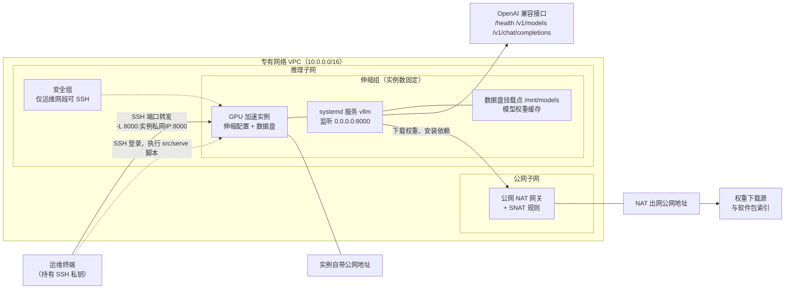

# 基于 GPU 加速实例的大模型推理服务（华为云实践）

[](LICENSE)
[](https://www.huaweicloud.com)

## 简介

本实践用 Terraform 在华为云上拉起一台 GPU 加速实例，并在实例内以 systemd 托管 [vLLM](https://github.com/vllm-project/vllm) 的 OpenAI 兼容推理服务，交付一条「从空目录到可以用 curl 调通一次对话」的完整链路。

它解决的问题是：大模型推理服务的部署形态里，**规格挑选、GPU 驱动、模型权重缓存、服务自恢复、访问通道**这五件事最容易各留一个坑。本实践把这五件事收敛成可复现的声明式配置与一组运维脚本：

- 规格挑选交给使用者：GPU 规格只在部分可用区上架，本实践不做自动挑选，必须显式给出 `var.gpu_flavor`（见「前置条件」与「分步部署」）。
- GPU 驱动与权重缓存交给镜像与数据盘：实例初始化脚本先校验 `nvidia-smi`，缺驱动就中止并写明原因；数据盘自动格式化并持久挂载，权重缓存落在数据盘上，实例重建不必重复下载。
- 服务自恢复交给 systemd：进程异常 10 秒后自动拉起，实例重启后自动恢复；承载实例的伸缩组负责健康检查与自动替换。
- 访问通道交给 SSH 端口转发：推理端口只在实例本机与 VPC 内监听，安全组只放通运维网段的 SSH 入口，服务不对公网开放。

适用于：需要在华为云上以单台 GPU 实例常驻跑一个 OpenAI 兼容推理服务端点的开发者、运维工程师，以及希望看清「Terraform 声明 + 实例内初始化 + 运行期运维脚本」三层如何衔接的读者。

## 目录

- [简介](#简介)
- [架构图](#架构图)
- [方案亮点](#方案亮点)
- [涉及云服务](#涉及云服务)
- [前置条件](#前置条件)
- [快速开始](#快速开始)
- [分步部署](#分步部署)
- [使用方法与验证](#使用方法与验证)
- [目录结构](#目录结构)
- [清理资源](#清理资源)
- [详细说明](#详细说明)
- [常见问题](#常见问题)
- [许可证](#许可证)
- [联系方式](#联系方式)

## 架构图



文字说明：

1. **网络**：VPC 内切两个子网。推理子网承载 GPU 实例，公网子网承载公网 NAT 网关。实例下载模型权重与安装依赖经 NAT 出网；创建公网 NAT 网关时由平台自动向 VPC 默认路由表注入 0.0.0.0/0 的下一跳，因此配置里不显式声明默认路由。
2. **入口**：每台伸缩出的实例自动带一个公网地址，仅作为 SSH 运维入口；安全组入方向只有来自 `var.ops_cidr` 的 SSH 规则，推理端口没有入方向规则。
3. **调用路径**：运维本机先用 SSH 把实例的推理端口转发到本机同名端口，随后所有 HTTP 请求都打到 `http://127.0.0.1:<端口>`，看起来就像在调用本地服务。
4. **实例内部**：伸缩配置里的 `user_data` 是渲染后的初始化脚本，首次启动依次完成驱动校验、数据盘挂载、虚拟环境装配、写入 systemd 单元并启动服务、有界探测 `/health`。
5. **存活保障**：`Restart=always` + `RestartSec=10` 负责进程级自愈，`NOVA_AUDIT` 健康检查负责实例级自动替换。

## 方案亮点

- **规格决策显式化**：GPU 规格、可用区、磁盘类型与容量、带宽模式全部作为输入变量给出，不依赖 provider 默认值，部署前必须逐条确认，避免「跑起来了但规格不对」。
- **初始化脚本自带前置校验**：没有 GPU 驱动时脚本直接中止并在日志里写明该改哪个参数，而不是让 vLLM 在几分钟后抛一个和驱动无关的错。
- **权重缓存与实例解耦**：独立数据盘持久化权重缓存目录（`HF_HOME`），配合 `delete_volume = true` 在实例被移出伸缩组时一并释放磁盘，不留无人认领的资源。
- **参数取值三层对齐**：`infra/variables.tf` 的输入变量、`infra/templates/vllm_bootstrap.sh.tpl` 渲染出的 systemd 单元、`src/serve/` 脚本的命令行与环境变量三处参数名一一对应；运维脚本按「命令行 > 同名环境变量 > 实例上已生效的服务配置 > 默认值」取值，不与部署声明漂移。
- **推理服务不对公网开放**：唯一的公网可达端口是受限网段的 SSH，调用一律走端口转发。
- **冒烟脚本可离线自证**：`src/client/` 的请求体构造、地址解析与错误分类都有单元测试，部署前即可跑通。

## 涉及云服务

| 华为云服务 | Terraform 资源 | 在本实践中的角色 |
|-|-|-|
| 专有网络 VPC | `huaweicloud_vpc` | 承载推理实例与 NAT 网关的隔离网络，网段由 `var.vpc_cidr` 给出 |
| 子网 | `huaweicloud_vpc_subnet.public` / `.private` | 公网子网承载 NAT 网关，推理子网承载 GPU 实例 |
| 公网 NAT 网关 | `huaweicloud_nat_gateway` | 为推理子网提供访问公网的出网通道，规格由 `var.nat_spec` 给出 |
| SNAT 规则 | `huaweicloud_nat_snat_rule` | 对推理子网整段网段做源地址转换，供下载权重与安装依赖使用 |
| 弹性公网 IP 与带宽 | `huaweicloud_vpc_eip`、伸缩配置内的 `public_ip` | 分别用于 NAT 出网与实例的 SSH 运维入口 |
| 安全组 | `huaweicloud_networking_secgroup` / `_rule` | 入方向只放通来自 `var.ops_cidr` 的 SSH，推理端口不开放入方向 |
| 密钥对（KPS） | `huaweicloud_kps_keypair` | 只登记公钥，私钥保留在运维人员本地 |
| 镜像（IMS） | `data.huaweicloud_images_image` | 按锚定正则在本区域公共镜像里定位实例镜像 |
| 弹性云服务器 ECS | 由伸缩组承载的实例 | GPU 加速实例，运行推理服务 |
| 块存储 EVS | 伸缩配置内的 `disk`（SYS / DATA） | 系统盘承载运行环境，数据盘持久化权重缓存 |
| 弹性伸缩 AS | `huaweicloud_as_configuration` / `huaweicloud_as_group` | 承载实例模板与实例数、可用区、健康检查与自动替换策略 |

## 前置条件

**账号与权限**

- 一个华为云账号，已开通弹性云服务器、弹性伸缩、虚拟私有云、NAT 网关、弹性公网 IP、云硬盘、密钥对、镜像、安全组相关服务。
- 执行账号具备上述服务的部署权限，可创建与删除资源。
- 在华为云「我的凭证」页面获取 Access Key ID 与 Secret Access Key，按 `infra/providers.tf` 顶部说明填入部署脚本；不要把凭据写入代码，也不要提交到仓库。

**工具版本**

- Terraform `>= 1.5.0`（见 `infra/versions.tf`）。
- huaweicloud provider `~> 1.96.1`（见 `infra/versions.tf`）。
- 调用客户端脚本需要 Python 3.8 以上与 `requests`（`python3 -m pip install requests`）。
- 实例内运维脚本需要 bash 4+、`curl`、systemd（`systemctl`），显存占用一项还需 GPU 驱动自带的 `nvidia-smi`。

**区域与可用区约束（务必逐条确认）**

- 目标区域默认 `cn-north-4`。
- **GPU 规格仅在部分可用区上架。** `var.availability_zone` 必须落在你的 GPU 规格实际可售的可用区；`cn-north-4` 需选 `cn-north-4b` 或 `cn-north-4c`。
- **`var.gpu_flavor` 必须由使用者按目标可用区的实际上架情况显式给出。** 仓库里的默认值 `g5.2xlarge.8` 只是让模板能通过校验，不构成任何可用性保证；正式部署前请在 `terraform.tfvars` 中覆盖为你确认过在售的规格名。可用区与规格二者不匹配时，伸缩组会创建实例失败。
- 换规格时同步核对显存容量与卡数，对应调整 `var.gpu_memory_utilization`、`var.max_model_len`、`var.tensor_parallel_size`（`var.tensor_parallel_size` 需与实例挂载的 GPU 卡数一致）。

**镜像约束**

- 实例镜像必须是**预装 GPU 驱动**的镜像。`var.image_id` 与 `var.image_name_regex` 默认都为空，部署前必须二选一给出取值：先在控制台「弹性云服务器 - 公共镜像」列表按当前区域确认镜像名与驱动版本，再把 `var.image_id` 直接指向该镜像，或把 `var.image_name_regex` 改成该镜像名的锚定正则（首尾必须用 `^` `$` 锚定，否则会命中名称相近的其它镜像）。两者都留空时规划阶段即中止，不会创建出无法提供推理服务的实例。
- 用不含 GPU 驱动的通用镜像部署时，实例内的初始化脚本会中止并在日志里写明「未检测到 GPU 驱动」，服务不会启动。

**访问通道约束**

- 准备好一对 SSH 密钥：公钥填入 `var.ssh_public_key`（OpenSSH 格式），私钥只留在运维本机。
- `var.ops_cidr` 必填且不得为 `0.0.0.0/0`，请把来源收敛到运维出口地址，形如 `<运维固定公网 IP>/32`。
- **推理服务只监听实例本机与 VPC 内，安全组没有放通推理端口。** 本机调用前必须先建立 SSH 端口转发，命令形态见「使用方法与验证」。

**出网约束**

- 实例首次启动需访问权重下载源与软件包索引。默认 `var.model_source_base_url = "https://huggingface.co"`、`var.python_package_index_url = "https://pypi.tuna.tsinghua.edu.cn/simple"`；建议按区域换成距离更近的站点，以缩短首启时间。

## 快速开始

```bash
cd infra
cp terraform.tfvars.example terraform.tfvars
# 编辑 terraform.tfvars：至少覆盖 gpu_flavor / availability_zone / image_id（或锚定的 image_name_regex）
#                        / ssh_public_key / ops_cidr
terraform init
terraform plan     -var-file=terraform.tfvars
terraform apply    -var-file=terraform.tfvars
```

预期输出（关键行）：

- `terraform validate` 阶段：`Success! The configuration is valid`（本地离线校验时另有 dev_overrides 提示，属预期）。
- `terraform apply` 结尾：`Apply complete! Resources: <N> added, 0 changed, 0 destroyed.` 并打印 `Outputs:`，其中包含 `access_guide`，即下面「使用方法与验证」的访问步骤。
- 实例首次启动到服务就绪通常需要 8 到 15 分钟（下载并加载模型权重）。

## 分步部署

### 第 1 步：确认规格与可用区

登录控制台或调用规格查询接口，确认目标可用区在售的 GPU 规格名，记下规格名与卡数。

预期产出：一个形如 `<规格族>.<规格名>` 的字符串，例如 `g5.2xlarge.8`，以及它的 GPU 卡数（用于 `var.tensor_parallel_size`）。

### 第 2 步：确认镜像

在「弹性云服务器 - 公共镜像」列表中按当前区域确认预装 GPU 驱动的镜像名与镜像 ID。

预期产出：镜像 ID（形如 `<32 位十六进制串>`），或可直接锚定匹配的镜像名。

### 第 3 步：填写变量

复制示例文件后按实际情况修改。`ssh_public_key` 与 `ops_cidr` 没有默认值，必须给出。

```bash
cd infra
cp terraform.tfvars.example terraform.tfvars
```

| 变量 | 类型 | 默认值 | 必填 | 说明与取值约束 |
|-|-|-|-|-|
| `region` | string | `cn-north-4` | 否 | 华为云区域 |
| `availability_zone` | string | `cn-north-4b` | 否 | 必须是 `var.gpu_flavor` 实际已上架的可用区；`cn-north-4` 只有 `4b` / `4c` 提供 GPU 规格 |
| `name_prefix` | string | `vllm-gpu` | 否 | 所有资源名称的统一前缀 |
| `vpc_id` | string | `""` | 否 | 复用已有 VPC 的 ID；留空则新建 |
| `public_subnet_id` | string | `""` | 否 | 复用承载 NAT 网关的子网 ID；留空则新建 |
| `private_subnet_id` | string | `""` | 否 | 复用承载推理实例的子网 ID；留空则新建 |
| `vpc_cidr` | string | `10.0.0.0/16` | 否 | 新建 VPC 的网段 |
| `public_subnet_cidr` | string | `10.0.1.0/24` | 否 | 新建公网子网网段 |
| `public_subnet_gateway_ip` | string | `10.0.1.1` | 否 | 需落在 `public_subnet_cidr` 内 |
| `private_subnet_cidr` | string | `10.0.10.0/24` | 否 | 新建推理子网网段 |
| `private_subnet_gateway_ip` | string | `10.0.10.1` | 否 | 需落在 `private_subnet_cidr` 内 |
| `gpu_flavor` | string | `g5.2xlarge.8` | **是** | **必须由使用者按目标可用区实际上架情况显式给出**；默认值只是让模板可校验。可选范围参考 `g5` / `g6` / `pi2` / `p2v` 等 GPU 规格族，均只在部分可用区提供。校验：不得为空 |
| `instance_count` | number | `1` | 否 | 同时作为伸缩组的最小、期望与最大实例数；取值 1-10 |
| `image_id` | string | `""` | 否 | 填写后忽略 `image_name_regex`，直接用该镜像创建实例 |
| `image_name_regex` | string | `""` | 二选一 | 未填 `image_id` 时必填；首尾必须用 `^` `$` 锚定，且需指向预装 GPU 驱动的镜像名 |
| `image_architecture` | string | `x86` | 否 | 需与 `gpu_flavor` 所属架构一致；只能是 `x86` 或 `arm` |
| `system_disk_type` | string | `GPSSD` | 否 | 取值 `SSD` / `SAS` / `SATA` / `GPSSD` / `ESSD` / `GPSSD2` / `ESSD2` |
| `system_disk_size` | number | `100` | 否 | 系统盘容量（GB），需容纳运行环境与权重缓存；取值 40-1024 |
| `enable_data_disk` | bool | `true` | 否 | 是否挂载独立数据盘用于持久化权重缓存 |
| `data_disk_type` | string | `GPSSD` | 否 | 取值同 `system_disk_type` |
| `data_disk_size` | number | `200` | 否 | 数据盘容量（GB），按所用模型权重体积放大；取值 10-32768 |
| `enable_nat_gateway` | bool | `true` | 否 | 是否创建公网 NAT 网关出网；确认实例可由自身公网地址直接出网时可置 `false` |
| `nat_spec` | string | `1` | 否 | NAT 网关规格取值 `1`（小型）/ `2`（中型）/ `3`（大型）/ `4`（超大型） |
| `nat_charging_mode` | string | `postPaid` | 否 | 取值 `postPaid` 或 `prePaid` |
| `nat_eip_type` | string | `5_bgp` | 否 | 出网公网地址类型，`5_bgp` 为动态 BGP |
| `nat_eip_charge_mode` | string | `traffic` | 否 | 带宽类型取值 `traffic` 或 `bandwidth` |
| `nat_eip_bandwidth_size` | number | `50` | 否 | 带宽上限（Mbit/s）：`traffic` 时取值 1-300，`bandwidth` 时取值 1-2000 |
| `instance_eip_type` | string | `5_bgp` | 否 | 实例公网地址类型，仅作 SSH 运维入口 |
| `instance_eip_charge_mode` | string | `traffic` | 否 | 带宽类型取值 `traffic` 或 `bandwidth` |
| `instance_eip_bandwidth_size` | number | `50` | 否 | 带宽上限（Mbit/s）：`traffic` 时取值 1-300，`bandwidth` 时取值 1-2000 |
| `instance_eip_share_type` | string | `PER` | 否 | 带宽共享方式取值 `PER`（独享）或 `WHOLE`（共享） |
| `ssh_public_key` | string | 无 | **是** | OpenSSH 格式公钥，形如 `ssh-ed25519 AAAA... user@host`；私钥保留在本地，不入仓库 |
| `ops_cidr` | string | 无 | **是** | 允许 SSH 的来源网段，形如 `<运维固定公网 IP>/32`；合法 CIDR 且不得为 `0.0.0.0/0` |
| `ssh_port` | number | `22` | 否 | SSH 端口，同时是安全组规则的端口范围 |
| `model_name` | string | `Qwen/Qwen2.5-0.5B-Instruct` | 否 | 请求体里的 `model` 字段需与之完全一致 |
| `max_model_len` | number | `8192` | 否 | 模型支持的最大序列长度 |
| `gpu_memory_utilization` | string | `0.85` | 否 | 分配给键值缓存的显存比例，取值 0 到 1 |
| `tensor_parallel_size` | number | `1` | 否 | 张量并行的显卡数量，需与实例挂载的 GPU 卡数一致 |
| `vllm_version` | string | `0.8.5` | 否 | 推理框架版本，按运行环境实际可用的版本固定 |
| `vllm_port` | number | `8000` | 否 | 推理服务监听端口，只在实例本机与 VPC 内监听，不对公网开放 |
| `model_source_base_url` | string | `https://huggingface.co` | 否 | 权重下载源地址，国内区域建议换成距离更近的镜像站点 |
| `python_package_index_url` | string | `https://pypi.tuna.tsinghua.edu.cn/simple` | 否 | 安装推理框架所用的软件包索引地址 |
| `model_cache_dir` | string | `/mnt/models/huggingface` | 否 | 权重缓存目录；启用数据盘时建议落在数据盘挂载点 `/mnt/models` 下 |
| `bootstrap_log_path` | string | `/var/log/vllm-setup.log` | 否 | 实例初始化脚本的日志路径 |

预期产出：`terraform plan` 无报错，输出中 `gpu_flavor`、`availability_zone`、`image_id` 与你的确认结果一致。

### 第 4 步：部署

```bash
cd infra
terraform apply -var-file=terraform.tfvars
```

预期输出：`Apply complete! Resources: <N> added, 0 changed, 0 destroyed.` 随后打印全部输出，包括 `region`、`availability_zone`、`vpc_id`、`instance_subnet_id`、`security_group_id`、`ssh_keypair_name`、`image_id`、`gpu_flavor`、`scaling_group_id`、`scaling_configuration_id`、`service_name`、`inference_port`、`model_name`、`access_guide`。

### 第 5 步：确认实例已就绪

伸缩组里的实例由平台创建，公网地址与私网地址请在控制台「弹性云服务器」列表查看，或执行：

```bash
cd infra
terraform state show huaweicloud_as_group.vllm
```

登录实例后查看初始化进度：

```bash
cat /var/log/vllm-setup.log
systemctl status vllm
journalctl -u vllm --no-pager -n 50
```

预期输出：日志末尾出现 `=== 推理服务初始化完成 ===`；若出现「未检测到 GPU 驱动，无法启动推理服务。」，请回到第 2 步换镜像。

## 使用方法与验证

### 部署前：离线验证（不需要任何云资源）

```bash
python -m unittest discover -s src/client -t src/client
```

预期输出（末两行）：

```text
----------------------------------------------------------------------
Ran 16 tests in 0.0Xs

OK
```

这一步校验客户端的请求体构造、地址解析优先级、Authorization 头开关与错误码归类，属部署前可做的静态校验。

### 部署后：建立访问通道

推理服务只监听实例本机与 VPC 内，安全组里只有来自 `var.ops_cidr` 的 SSH 入方向规则，**推理端口没有开放**。因此本机调用前必须先建立 SSH 端口转发（把本地 8000 映射到实例 8000），并保持该终端运行：

```bash
ssh -i <本地私钥文件> -N -L 8000:<实例私网IP>:8000 root@<实例公网IP>
```

这与 `terraform output access_guide` 以及 `src/serve/vllm-env.sh` 末尾的访问提示给出的命令形态一致；端口两处都取 `var.vllm_port`（默认 `8000`）。

### 部署后：健康探活

方式一，直接用 curl：

```bash
curl -s -o /dev/null -w "%{http_code}\n" http://127.0.0.1:8000/health
```

预期输出：`200`（返回 200 即表示服务可用；首次启动需下载并加载模型权重，通常 8 到 15 分钟）。

方式二，用客户端脚本一次做完健康探活与模型名确认：

```bash
cd src/client
python3 health_check.py --base-url http://127.0.0.1:8000/v1
```

预期输出：

```text
GET http://127.0.0.1:8000/health -> HTTP 200
GET http://127.0.0.1:8000/v1/models -> 已返回模型列表
服务已加载模型（1 个）：
  Qwen/Qwen2.5-0.5B-Instruct  <= 本次 --model
请求体 model  : Qwen/Qwen2.5-0.5B-Instruct（列表中已存在）
结果          : 通过
```

加 `--require-model` 时，若服务列出的模型名里没有 `--model` 指定的名称，脚本按退出码 `5` 失败，用于区分「服务活着」与「模型名写错」。

### 部署后：一次非流式对话

```bash
cd src/client
python3 chat_completion.py --base-url http://127.0.0.1:8000/v1
```

预期输出：

```text
--- 非流式对话补全 ---
接口地址      : http://127.0.0.1:8000/v1/chat/completions
模型          : Qwen/Qwen2.5-0.5B-Instruct
首 token 延迟 : -
整体耗时      : 1234 ms
返回分片数    : 1
token 统计    : prompt=25 completion=64 total=89
返回内容      : <模型返回的文本，最多显示 200 字符>
结果          : 通过
```

非流式调用不统计首 token 延迟，该行固定显示 `-`。可用参数：`--prompt`、`--system-prompt`、`--temperature`、`--max-tokens`、`--model`、`--api-key`、`--timeout`、`--eip`、`--port`、`--skip-model-check`。

同样的调用也可以用原始请求形态复现：

```bash
curl http://127.0.0.1:8000/v1/chat/completions \
  -H "Content-Type: application/json" \
  -d '{"model": "Qwen/Qwen2.5-0.5B-Instruct", "messages": [{"role": "user", "content": "你好"}], "max_tokens": 100}'
```

### 部署后：一次流式对话

```bash
cd src/client
python3 stream_chat_completion.py --base-url http://127.0.0.1:8000/v1
```

预期输出：

```text
请求体 stream=True，逐分片读取 SSE。
--- 流式对话补全 ---
接口地址      : http://127.0.0.1:8000/v1/chat/completions
模型          : Qwen/Qwen2.5-0.5B-Instruct
首 token 延迟 : 412 ms
整体耗时      : 1500 ms
返回分片数    : 62
返回内容      : <模型返回的文本，最多显示 200 字符>
结果          : 通过
```

流式默认只打印汇总，加 `--show-chunks` 可逐行打印分片内容；未读到任何非空分片时会额外提示确认服务是否真的按流式返回。

### 部署后：在实例内做运行期运维

四个动作脚本在推理实例内以 root 身份执行（`vllm-env.sh` 是它们共用的函数库，不单独执行）。这些脚本不在伸缩配置的 `user_data` 里，需先手工上传一次到实例（例如 `/opt/src/serve/`）；上传前也可先在运维本机执行同样的命令，无 `systemctl` / `nvidia-smi` 时相应字段会自动跳过：

```bash
scp -i <本地私钥文件> src/serve/*.sh root@<实例公网IP>:/opt/src/serve/
```

上传后在实例内执行：

```bash
src/serve/vllm-status.sh            # 服务状态 + 端口监听 + 显存占用 + 接口探测，只读
src/serve/vllm-logs.sh -n 50        # 服务输出与初始化日志
src/serve/vllm-start.sh --dry-run   # 只打印生效参数与服务配置内容，不做变更
src/serve/vllm-stop.sh              # 停止实例内的服务进程，不影响伸缩组本身
```

`vllm-status.sh` 退出码：健康检查返回 200 时退出 `0`，其他情况退出 `1` 并逐行写明原因。运维本机已建立端口转发时可直接探测接口侧字段：

```bash
src/serve/vllm-status.sh --port 8000
```

### 客户端脚本退出码约定

| 退出码 | 含义 | 常见处理 |
|-|-|-|
| `0` | 成功 | — |
| `2` | 连不上服务 | 端口转发未建立，或服务仍在加载权重 |
| `3` | 请求超时 | 加大 `--timeout` 后重试 |
| `4` | 认证失败（401/403） | 用 `--api-key` 传入实际密钥，或设 `VLLM_API_KEY` |
| `5` | 模型名不存在（404） | 与 `health_check.py` 列出的名称对齐（对应 `var.model_name`） |
| `6` | 服务端返回 5xx | `src/serve/vllm-logs.sh -n 100` 看日志 |
| `7` | 响应结构不符合接口约定 / 地址不合法 | 检查 `--base-url` 协议与拼接结果 |
| `8` | 缺少 `requests` 依赖 | `python3 -m pip install requests` |

取值优先级：命令行参数 > 同名环境变量（`VLLM_BASE_URL` / `VLLM_EIP` / `VLLM_PORT` / `MODEL_NAME` / `VLLM_API_KEY` / `REQUEST_TIMEOUT` / `MAX_TOKENS` / `SMOKE_PROMPT` / `SMOKE_SYSTEM_PROMPT` / `SMOKE_TEMPERATURE`）> 脚本内默认值。本实践的服务未启用访问密钥，`--api-key` 留空即不带 `Authorization` 头。

> **请在部署完成后按本节步骤在真实环境自行验证**：先确认 `/health` 返回 200，再确认 `/v1/models` 列出的模型名与 `var.model_name` 一致，最后各跑一次非流式与流式对话。三类请求都返回预期结果，方可视为交付完成。

## 目录结构

```text
.
├── docs/
│   ├── architecture.md          # 架构组成、数据流与关键设计取舍
│   └── deployment-guide.md      # 从零到可验证部署的分步命令
├── infra/
│   ├── compute.tf               # 密钥对、镜像、伸缩配置与伸缩组
│   ├── locals.tf                # 网络选址、命名、标签与初始化脚本渲染
│   ├── network.tf               # VPC、子网、NAT 网关与 SNAT 规则
│   ├── outputs.tf               # 对外输出，含 access_guide
│   ├── providers.tf             # Provider 配置与凭据获取说明
│   ├── security.tf              # 安全组与 SSH 入方向规则
│   ├── templates/
│   │   └── vllm_bootstrap.sh.tpl # 实例首次启动的初始化脚本模板
│   ├── terraform.tfvars.example # 变量示例，逐条注释
│   ├── variables.tf             # 输入变量与校验
│   └── versions.tf              # Terraform 与 provider 版本约束
├── src/
│   ├── client/                  # 推理接口冒烟客户端（Python）
│   │   ├── client_common.py
│   │   ├── chat_completion.py
│   │   ├── health_check.py
│   │   ├── smoke_common.py
│   │   ├── stream_chat_completion.py
│   │   └── test_smoke_client.py
│   └── serve/                   # 实例内运维脚本（bash）
│       ├── vllm-env.sh
│       ├── vllm-logs.sh
│       ├── vllm-start.sh
│       ├── vllm-status.sh
│       └── vllm-stop.sh
├── README.md
├── README.en.md
└── LICENSE
```

## 清理资源

```bash
cd infra
terraform destroy -var-file=terraform.tfvars
```

预期输出：`Destroy complete! Resources: <N> destroyed.`

要点：

- 伸缩组声明了 `delete_publicip = true`、`delete_volume = true`、`delete_instances = "yes"`，实例被移出伸缩组时会一并释放其公网地址与磁盘，避免留下无人认领的残留资源。
- 若复用了已有 VPC 或子网（`vpc_id` / `public_subnet_id` / `private_subnet_id` 非空），这些资源本就不由本实践创建，`destroy` 不会动它们。
- 权重缓存所在的数据盘随实例一并释放；若希望保留权重供下次部署复用，请在 `destroy` 前把数据盘内容导出。
- 实践结束后请及时释放资源，避免残留。

## 详细说明

- 架构组成、数据流与关键设计取舍：[docs/architecture.md](docs/architecture.md)
- 从零到可验证部署的分步命令与逐条预期输出：[docs/deployment-guide.md](docs/deployment-guide.md)

## 常见问题

**伸缩组创建不出实例，报规格不可售。**
`var.gpu_flavor` 与 `var.availability_zone` 不匹配。GPU 规格只在部分可用区上架，请到控制台确认该可用区实际可售的规格名后覆盖 `gpu_flavor`，或把 `availability_zone` 换成该规格在售的可用区（`cn-north-4` 为 `4b` / `4c`）。

**服务没有起来，日志里写「未检测到 GPU 驱动，无法启动推理服务。」**
用的是通用镜像。请把 `var.image_id` 指向本区域预装 GPU 驱动的公共镜像，或把 `var.image_name_regex` 改成该镜像名的锚定正则后重新部署。

**`image_name_regex` 命中了意料之外的镜像。**
正则没有首尾锚定。配置里的 `precondition` 会拦截不含 `^` 与 `$` 的取值；请把名称写成 `^<完整镜像名>$`。

**`/health` 长时间返回 `000`。**
首次启动需要下载并加载模型权重，通常 8 到 15 分钟。在实例内依次确认：`cat /var/log/vllm-setup.log`、`systemctl status vllm`、`src/serve/vllm-status.sh`。初始化脚本里的就绪探测窗口是有界的（每 10 秒一次、最多 120 次），超时不影响部署结果，服务仍由 systemd 持续拉起。

**端口转发后仍然连不上（客户端退出码 `2`）。**
按次序确认：转发窗口是否还活着、`-L` 两侧的端口是否与 `var.vllm_port` 一致、`<实例私网IP>` 是否为伸缩组里当前实例的私网地址（实例被自动替换后地址会变）、实例内服务是否已就绪。

**客户端退出码 `5`，模型名不存在。**
请求体里的 `model` 必须与服务 `/v1/models` 列出的名称完全一致。先跑 `python3 health_check.py`，再核对 `var.model_name` 与实例上 systemd 单元里的 `--model` 取值。

**想用 OpenAI 官方 SDK 调用。**
把 `base_url` 指向端口转发后的本机地址（形如 `http://127.0.0.1:8000/v1`），`api_key` 留空即可；本实践的服务未启用访问密钥。推理端口不对公网开放，不要试图直连实例公网地址。

## 许可证

本实践采用 MIT No Attribution 许可证发布，详见 [LICENSE](LICENSE)。

## 联系方式

本实践的创建与维护团队：公有云持续运营部。
