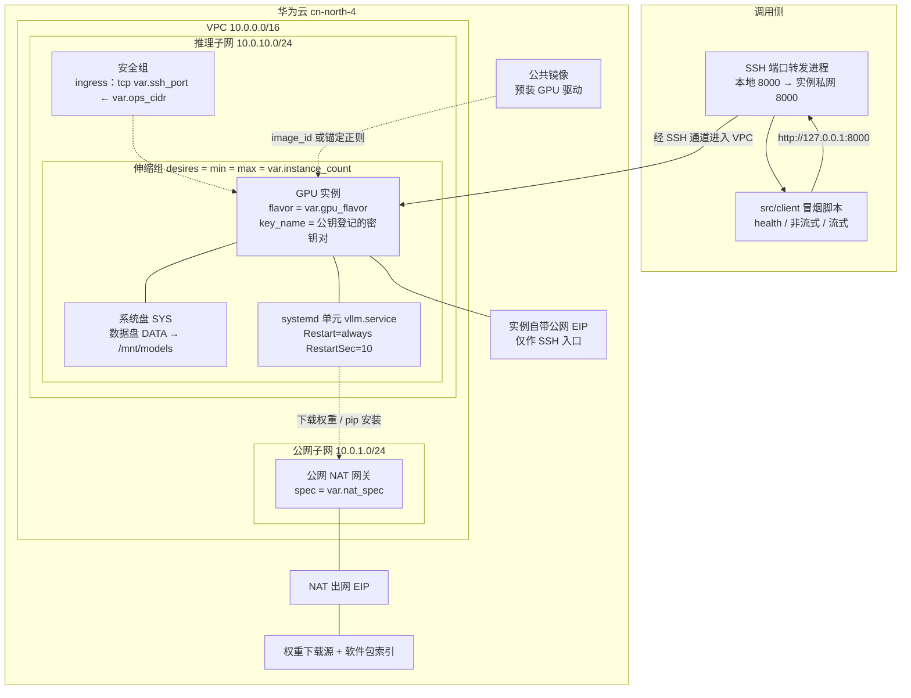
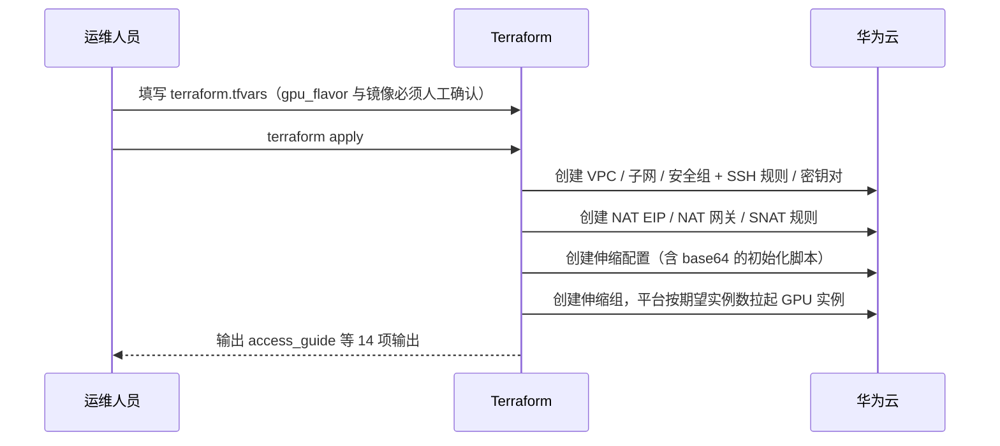
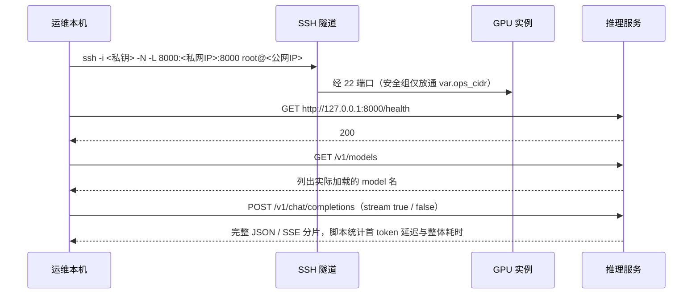

# 架构说明

本文说明本实践的架构组成、端到端数据流与关键设计取舍。所有结论均来自仓库现有配置与脚本，逐条可回溯到文件。

## 1. 分层视角

整套交付分成四层，每层职责单一、边界清晰：

| 层 | 载体 | 职责 | 不做的事 |
|-|-|-|-|
| 声明层 | `infra/*.tf` | 描述网络、入口、实例模板、磁盘与出网通道的最终形态 | 不挑选 GPU 规格、不自动发现镜像 |
| 初始化层 | `infra/templates/vllm_bootstrap.sh.tpl`（经 `local.bootstrap_script` 渲染后以 `base64encode` 写入伸缩配置的 `user_data`） | 实例首启时装载运行环境、挂载数据盘、写 systemd 单元并启动服务 | 不做二次网络变更，不回写 Terraform 状态 |
| 运行期层 | `src/serve/vllm-*.sh`（`vllm-env.sh` 为共用函数库） | 在实例内做启动、停止、状态、日志四类运维动作 | 不访问云端管理接口，不修改伸缩组 |
| 调用层 | `src/client/*.py` | 通过 OpenAI 兼容接口做探活与非流式/流式对话冒烟 | 不下载权重、不调用云端管理接口 |

四层之间只有一条对齐契约：**参数名**。`infra/variables.tf` 的输入变量、模板渲染出的 systemd 单元命令行、`src/serve/vllm-env.sh` 的大写环境变量名三者一一对应（例如 `var.vllm_port` ↔ 单元里的 `--port` ↔ `VLLM_PORT`），因此运行期读到的取值可以直接追溯到部署声明。

## 2. 组件清单

各组件的职责与出处：

- **VPC 与两个子网**（`network.tf`）：`huaweicloud_vpc.main` 承载整体网络；`huaweicloud_vpc_subnet.public` 只用于挂 NAT 网关；`huaweicloud_vpc_subnet.private` 承载推理实例。两个子网都固定在 `var.availability_zone`。三者都带 `count`，由 `local.create_vpc / create_public / create_private` 决定「留空即新建，填写即复用」。
- **公网 NAT 网关与 SNAT 规则**（`network.tf`）：`huaweicloud_nat_gateway.main` 挂在公网子网，`huaweicloud_nat_snat_rule.instance` 以 `source_type = 0` 对推理子网整段网段做源地址转换，使实例无需自身出网能力即可下载权重与安装依赖。`enable_nat_gateway = false` 时三者一并关闭。
- **弹性公网 IP**（`network.tf` 与 `compute.tf`）：`huaweicloud_vpc_eip.nat` 服务于 NAT 出网；实例侧的地址由伸缩配置里的 `public_ip { eip { ... } }` 自动分配，只承担 SSH 运维入口。
- **安全组**（`security.tf`）：只有一条 ingress 规则（`tcp`，`port_range_min = port_range_max = var.ssh_port`，`remote_ip_prefix = var.ops_cidr`）。出方向不声明规则——创建安全组时平台自带一条放通全部出方向的默认规则，重复声明会与默认规则冲突。
- **密钥对**（`compute.tf`）：`huaweicloud_kps_keypair.ops` 只登记公钥；私钥不入仓库、不入状态文件。
- **镜像**（`compute.tf`）：`data.huaweicloud_images_image.selected` 在 `var.image_id` 为空时生效，按 `visibility = "public"`、`most_recent = true` 与 `var.image_name_regex` 定位；两条 `precondition` 分别要求正则非空、且必须同时含 `^` 与 `$`。
- **伸缩配置**（`compute.tf`）：作用相当于一份可复用的实例模板，声明 `flavor`、`image`、`key_name`、`user_data`（base64 后的初始化脚本）、`security_group_ids`、系统盘与可选数据盘、公网地址。
- **伸缩组**（`compute.tf`）：`desire/min/max_instance_number` 都取 `var.instance_count`；`availability_zones = [var.availability_zone]` 与 `multi_az_scaling_policy = "PICK_FIRST"` 把实例固定在指定可用区；`health_periodic_audit_method = "NOVA_AUDIT"`、`health_periodic_audit_time = 5`、`instance_terminate_policy = "OLD_INSTANCE"` 负责实例级自愈；`delete_publicip / delete_volume / delete_instances = "yes"` 保证实例被移出时不留残料。
- **systemd 单元**（模板渲染，或 `vllm-env.sh` 的 `vllm_render_unit` 生成，两者逐行同形）：`ExecStart` 指向虚拟环境内的 `python -m vllm.entrypoints.openai.api_server`，参数为 `--model`、`--host 0.0.0.0`、`--port`、`--tensor-parallel-size`、`--max-model-len`、`--gpu-memory-utilization`、`--enable-prefix-caching`；`Environment` 里设 `HF_HOME`、`HF_ENDPOINT`、`HF_HUB_ENABLE_HF_TRANSFER=0`。

## 3. 数据流

### 3.1 部署流

`terraform apply` 只保证「资源形态声明成功」，不保证「推理服务已就绪」——服务就绪发生在实例内部，见 3.2。

### 3.2 实例首启流

初始化脚本（`vllm_bootstrap.sh.tpl`）按固定次序执行，任一硬前提不满足即中止：

1. `exec > >(tee -a "$BOOTSTRAP_LOG") 2>&1`：全过程输出同时写入 `var.bootstrap_log_path`，登录实例可直接查看。
2. 等 `dpkg` 前端锁释放（镜像自身首启初始化可能仍在跑），再动 `apt`。
3. **GPU 驱动校验**：`command -v nvidia-smi` 不存在则打印「未检测到 GPU 驱动，无法启动推理服务。」并 `exit 1`；存在则打印 `nvidia-smi` 结果。
4. **数据盘**：`lsblk` 找出非系统盘，无文件系统时 `mkfs.ext4`，取 UUID 写入 `/etc/fstab`（`defaults,nofail`）挂载到 `local.data_disk_mount_point`（`/mnt/models`），随后 `mkdir -p "$MODEL_CACHE_DIR"`。找不到数据盘时改为「权重写入系统盘」，不中止。
5. **依赖与框架**：`apt-get install python3-pip python3-venv curl`，`python3 -m venv /opt/vllm-env`，再用 `var.python_package_index_url` 升级 `pip` 并安装 `vllm==var.vllm_version`。
6. **写 systemd 单元并 enable + start**，服务名固定 `vllm`（对应 `output.service_name`）。
7. **有界就绪探测**：每 10 秒 `curl -fs http://127.0.0.1:<端口>/health`，最多 120 次。就绪打印「推理服务已就绪，健康检查通过。」；超时只打印排查指引，不影响部署结果——进程由 `Restart=always` 持续拉起。

### 3.3 调用流

关键点：推理端口的可达性完全依赖 22 端口建立的通道。`src/client/client_common.py` 的 `resolve_base_url` 因此把显式 `--base-url` 放在第一位；只有在使用者自行放通安全组的前提下，`--eip` 拼接出的公网直连地址才可用。

### 3.4 故障自愈的两级边界

| 现象 | 由谁处理 | 处理动作 | 使用者需要做什么 |
|-|-|-|-|
| 服务进程异常退出 | systemd | `Restart=always` + `RestartSec=10` 自动拉起 | 无需介入，可看 `journalctl -u vllm` |
| 实例本身异常 | 伸缩组 | `NOVA_AUDIT` 每 5 分钟审计，异常时按 `OLD_INSTANCE` 策略替换 | **实例的私网与公网地址会变，SSH 隧道与客户端地址需重建** |

## 4. 关键设计取舍

**① GPU 规格不自动挑选，必须由使用者显式给出。**
GPU 规格族仅在部分可用区上架，且各区域可售清单会变动。任何「查询可用规格后自动挑一个」的写法都会让部署结果依赖运行时的库存状态，同一份配置在不同时间得到不同实例形态。本实践选择把决策权交出去：`var.gpu_flavor` 只有一条非空校验，默认值 `g5.2xlarge.8` 的存在仅是让模板能通过校验，配置文件与 `terraform.tfvars.example` 都写明「正式部署前请覆盖为目标可用区实际可售的规格」。代价是部署前多一次人工确认，收益是规格与可用区的匹配关系由使用者负责、结果可预期。

**② 镜像正则强制首尾锚定。**
公共镜像命名相近（同名镜像存在多个变体），不锚定就会命中预期之外的镜像，最典型的后果是拿到不含 GPU 驱动的镜像，服务在几分钟后以一堆无关错误失败。配置用 `precondition` 硬性拒绝不含 `^` `$` 的正则，初始化脚本再补一道 `nvidia-smi` 校验，两处任一失败都能给出可定位的原因。

**③ 用伸缩组承载单台常驻实例，而不是裸 ECS。**
声明式地管理一台 ECS 也能跑服务，但缺少实例级的自动替换。伸缩组把「期望实例数 = 1」与「健康检查 + 自动替换」组合起来，等于给常驻推理服务加了一层免费的存活保障，同时 `delete_publicip / delete_volume / delete_instances` 三个开关让替换与销毁过程不留无人认领的公网地址与磁盘。这里不做横向扩容：`desire/min/max` 三者同值，`multi_az_scaling_policy = "PICK_FIRST"`。`desire_instance_number` 上带 `ignore_changes`，因为该值由伸缩组在运行期自行维护，不应被声明值回写。

**④ 推理端口不对公网开放，本机访问统一走 SSH 端口转发。**
`security.tf` 只有一条来自 `var.ops_cidr` 的 SSH ingress，`var.vllm_port` 没有任何入方向规则。收益是攻击面收敛到一个受密钥与来源网段双重限制的口；代价是本机调用多一步隧道，且隧道有保持常驻的要求。这一约束同时写在三处，使用者不会漏看：`output.access_guide`、`src/serve/vllm-env.sh` 末尾的访问提示、`src/client/client_common.py` 的访问通道说明。

**⑤ 权重缓存放数据盘，且随实例一并释放。**
模型权重的下载与加载是首启耗时的大头（通常 8 到 15 分钟）。把 `HF_HOME` 落在独立数据盘的挂载点 `/mnt/models` 下，配合初始化脚本的 `blkid`/`fstab` 逻辑，可以让实例在同一块盘存活期内重复启动都不必重新下载。与 `delete_volume = true` 并置是有意的：盘随实例释放，不为零散资源留尾。

**⑥ 服务由 systemd 托管，不引入容器或托管平台。**
本实践的形态是「一台实例跑一个推理端点」。`Restart=always` + `enable` 已经覆盖进程自愈与开机恢复，而引入容器编排会把注意力从「推理服务怎么跑起来」转移到「编排怎么配」。同样出于这个考虑，`src/serve/` 只保留四个动作脚本加一个函数库，全部走 systemd，不做第二套控制面。

**⑦ 运行期参数取值不写死，按四层优先级读取。**
`vllm-env.sh` 的 `vllm_finalize_params` 按「命令行参数 > 同名环境变量 > 实例上已生效的服务配置（解析 `ExecStart` 与 `Environment`）> 脚本内默认值」合成最终取值，并记录每项来源供 `vllm_print_params` 打印。这保证了在实例上直接跑 `vllm-status.sh` 时看到的端口、模型名就是部署真正下发的值，不会因为脚本自带默认而与 infra 声明漂移。

**⑧ 就绪探测有界，不把部署结果绑在模型加载时长上。**
初始化脚本最多等 120 轮、每轮 10 秒。超时不 `exit 1`，只打印 `systemctl status` 与 `journalctl` 的排查入口。理由：首次加载时长受模型大小与出网带宽影响，若让它决定部署成败，`apply` 会随机失败。

## 5. 边界与已知约束

- **可用区与规格强绑定**：`var.availability_zone` 必须是 `var.gpu_flavor` 实际已上架的可用区（`cn-north-4` 为 `4b` / `4c`）。二者不匹配时伸缩组创建实例失败，本实践不做兜底。
- **镜像必须显式给出**：`var.image_id` 与 `var.image_name_regex` 默认都是空串，两者都留空时 `compute.tf` 的 `precondition` 在规划阶段就中止；填入通用镜像时实例内的初始化脚本会中止。选定预装 GPU 驱动的镜像是必做动作，不是可选优化。
- **张量并行度需与卡数一致**：`var.tensor_parallel_size` 与 `var.gpu_flavor` 的 GPU 卡数不一致会导致服务启动失败。
- **模型名严格一致**：请求体里的 `model` 必须与 `/v1/models` 列出的名称完全相同，对应 `var.model_name`；`health_check.py --require-model` 用退出码 `5` 专门区分这种情况。
- **单实例常驻，无横向扩容**：伸缩组实例数固定，只承担健康检查与自动替换。多副本分摊流量不在本实践范围内。
- **实例替换后地址变化**：SSH 隧道里的 `<实例公网IP>` 与 `<实例私网IP>` 需要在替换后重新确认。
- **服务未启用访问密钥**：`--api-key` 留空即不带 `Authorization` 头。若使用者自行加上密钥，需同步更新调用方式。
- **首启依赖出网可达**：关闭 `enable_nat_gateway` 前需确认实例可由自身公网地址直接出网，否则权重下载与依赖安装会失败。

## 6. 相关文件

- 配置：`infra/variables.tf`、`infra/compute.tf`、`infra/network.tf`、`infra/security.tf`、`infra/locals.tf`、`infra/outputs.tf`、`infra/templates/vllm_bootstrap.sh.tpl`
- 运行期脚本：`src/serve/vllm-env.sh`、`src/serve/vllm-start.sh`、`src/serve/vllm-stop.sh`、`src/serve/vllm-status.sh`、`src/serve/vllm-logs.sh`
- 客户端：`src/client/client_common.py`、`src/client/smoke_common.py`、`src/client/health_check.py`、`src/client/chat_completion.py`、`src/client/stream_chat_completion.py`
- 部署步骤：`docs/deployment-guide.md`
